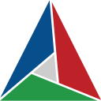

<h1 align="center">Hi 🦆, I'm Teodor Cirstoiu</h1>
<h3 align="center">A passionate Graphics & Deep Learning Researcher from Canada</h3>

  std::cout <<
  <a href="https://linkedin.com/in/teodor-cirstoiu" target="_blank">
    Linkedin
  </a>
  <<
  <a href="https://www.leetcode.com/ahria" target="_blank">
    Leetcode
  </a>
  <<
  <a href="https://stackoverflow.com/users/28913972/ahria" target="_blank">
    Stackoverflow
  </a>
    << std::endl;

  
  &nbsp;&nbsp;
  
  &nbsp;&nbsp;
  
  &nbsp;&nbsp;
  
  &nbsp;&nbsp;
  

&nbsp;&nbsp;&nbsp;&nbsp;In the era of artificial intelligence and ever-increasing graphical compute, we’ve largely taken the approach of pushing our architectures further to do more. However, one aspect of computer graphics that I have always loved is optimization theory. Rather than researching ways to do more with more, I’m personally interested in how we can do “**more with less**,” especially when it comes to optimizing rendering pipelines through innovations in deep learning and computer vision. Computer simulations and games have reached incredible levels of visual fidelity; however, I want to make these experiences accessible to older computers as well and help democratize access to high-compute graphics.

🎉 All of my projects will be available at [WIP Portfolio](https://github.com/C-Teo) (I'm building something [cool](https://threejs.org/) for this ... so it'll take a bit!)

  
  &nbsp;&nbsp;
  
  &nbsp;&nbsp;
  
  &nbsp;&nbsp;
  
  &nbsp;&nbsp;
  
  &nbsp;&nbsp;
  
  &nbsp;&nbsp;
  
  &nbsp;&nbsp;
  
  &nbsp;&nbsp;
  
  &nbsp;&nbsp;
  
  &nbsp;&nbsp;
  
  &nbsp;&nbsp;
  

---

<em>“The struggle itself towards the heights is enough to fill a man's heart. One must imagine Sisyphus happy.”</em> — <strong>Albert Camus</strong>

